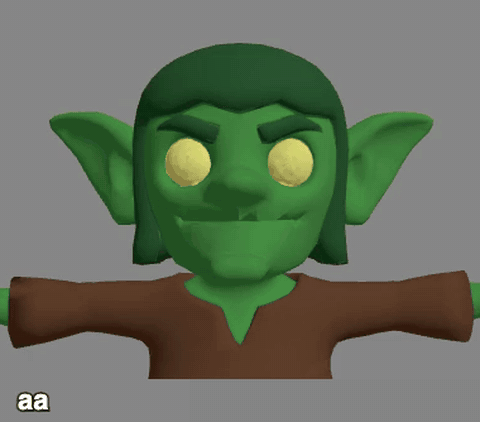
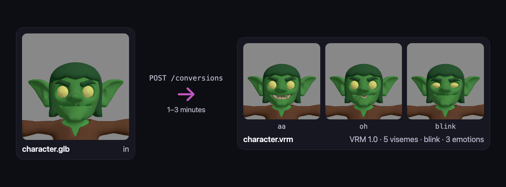

# GLB to VRM API: a talking VRM 1.0 avatar from a 3D model or a picture

Send the [Riggle](https://riggle3d.com) API a GLB (rigged or not), an existing
VRM, or a single picture of a character. Get back a VRM 1.0 avatar with
humanoid bones, five visemes, blinks and three emotions, ready for lip
sync. This repository holds runnable examples: three curl calls, and a
one-file client for Python and for Node with no dependencies.

<p align="center"></p>

```bash
python python/riggle.py convert character.glb -o character.vrm
```

- API reference: <https://riggle3d.com/en/guides/vrm-api>
- OpenAPI 3.1 spec: [`openapi.json`](openapi.json), also at <https://riggle3d.com/openapi.json>
- API keys: <https://app.riggle3d.com/developers/> (the API is paid in API
  tokens; a key works once a pack is bought)

## Quick start: convert GLB to VRM with curl

Upload, poll, download. That is the whole API.



```bash
export RIGGLE_API_KEY=rgl_...
API=https://app.riggle3d.com/api/v1

# 1. Upload the model
id=$(curl -s -X POST $API/conversions \
  -H "Authorization: Bearer $RIGGLE_API_KEY" \
  -F file=@character.glb | jq -r .id)

# 2. Wait until it is no longer processing (1-3 minutes for a rigged model)
until [ "$(curl -s $API/conversions/$id \
  -H "Authorization: Bearer $RIGGLE_API_KEY" | jq -r .status)" != processing ]
do sleep 4; done

# 3. Download the VRM
curl -s -o character.vrm $API/conversions/$id/vrm \
  -H "Authorization: Bearer $RIGGLE_API_KEY"
```

For image to VRM, send a picture in the `image` field instead of `file`:

```bash
curl -s -X POST $API/conversions \
  -H "Authorization: Bearer $RIGGLE_API_KEY" \
  -F image=@hero.png
```

A picture is checked before anything is charged. If it is not one whole
character facing the camera, the API answers `422 picture_rejected` with the
reasons; add `-F fix=true` to have it redrawn first, or `-F force=true` to use
it as it is.

[`examples/curl.sh`](examples/curl.sh) is the same thing with error handling:
`./examples/curl.sh character.glb` or
`./examples/curl.sh --image hero.png [--fix|--force]`.

## CLI and client library

Both clients are a single file you can copy into a project. They upload, poll
every 4 seconds while printing the current stage, download the VRM, print any
warnings, and exit non-zero if the conversion fails.

### Python (3.9+, standard library only)

```bash
export RIGGLE_API_KEY=rgl_...

python python/riggle.py convert model.glb -o model.vrm --preview preview.mp4
python python/riggle.py convert --image hero.png -o hero.vrm
python python/riggle.py convert --image sheet.png -o hero.vrm --fix   # or --force
python python/riggle.py fix-picture sheet.png -o fixed.png
python python/riggle.py balance
python python/riggle.py list
```

```python
from riggle import Riggle, ConversionFailed

client = Riggle()  # reads RIGGLE_API_KEY, or pass the key in
try:
    conversion = client.convert("model.glb", "model.vrm", preview="preview.mp4")
    for warning in conversion["warnings"]:
        print("check the preview:", warning)
except ConversionFailed as failure:
    print(failure.message)  # the tokens were returned
```

### Node (18+, zero dependencies)

```bash
node node/riggle.mjs convert model.glb -o model.vrm --preview preview.mp4
node node/riggle.mjs convert --image hero.png -o hero.vrm
node node/riggle.mjs convert --image sheet.png -o hero.vrm --fix   # or --force
node node/riggle.mjs fix-picture sheet.png -o fixed.png
node node/riggle.mjs balance
node node/riggle.mjs list
```

```js
import { Riggle } from './riggle.mjs';

const client = new Riggle(); // reads RIGGLE_API_KEY, or pass the key in
const conversion = await client.convert('model.glb', 'model.vrm');
await client.convert({ image: 'hero.png', output: 'hero.vrm', preview: 'hero.mp4' });
await client.convert({ image: 'sheet.png', output: 'hero.vrm', fix: true }); // or force: true
```

In Python the same options are `client.convert(image="sheet.png",
output="hero.vrm", fix=True)` and `force=True`. The redraw on its own is
`client.fix_picture("sheet.png", "fixed.png")` in Python and
`await client.fixPicture('sheet.png', 'fixed.png')` in Node.

Both read `RIGGLE_API_KEY`, and `RIGGLE_API_URL` if you need to override the
base URL. Both send an `Idempotency-Key` with the upload, so a retry after a
dropped connection returns the first conversion instead of starting, and
charging, a second one.

### More examples

| File | What it shows |
| --- | --- |
| [`examples/curl.sh`](examples/curl.sh) | The three calls with `curl` and `jq`, for a model or a picture |
| [`examples/batch.py`](examples/batch.py) | Convert every `.glb` in a folder, three at a time, stopping cleanly when tokens run out |
| [`examples/three-vrm-viewer/`](examples/three-vrm-viewer/index.html) | A static page that loads a `.vrm` with three-vrm and plays its visemes and blinks |
| [`.github/workflows/convert.yml`](.github/workflows/convert.yml) | A manually triggered GitHub Action that converts `models/*.glb` and uploads the VRMs as artifacts |

## What comes out

A VRM 1.0 file containing:

- **Humanoid bones**, so the avatar can be posed, animated and retargeted.
- **Five visemes**: `aa`, `ih`, `ee`, `oh`, `ou`, the mouth shapes lip sync is
  driven by.
- **Blinks**: `blink`, `blinkLeft`, `blinkRight`.
- **Emotions**: `happy`, `angry`, `surprised`.
- **lookAt**, so the eyes can follow a target, when the rig has eye bones.

Alongside the file you get a preview video that plays every expression, and
still images of them, so you can check the result without loading it anywhere.

### Why a GLB to VRM converter needs to do more than convert

VRM is a glTF binary with extra data: which bone is the head, which
blendshape is "aa", where the eyes look. A converter that only rewrites the
container, or only fills in the bone map, gives you a file that loads fine
and an avatar whose mouth never moves. Most models from Tripo, Meshy or a
Mixamo-rigged export have no facial blendshapes at all, so there is nothing
to map: the mouth shapes have to be built.

Everything that makes a VRM avatar look alive reads those expressions by
name:

- A three-vrm scene driving `aa`/`ih`/`ou`/`ee`/`oh` from text-to-speech
  audio, which is how most AI companions and talking characters on the web
  work.
- VTuber avatar software and face tracking, which map your mouth and eyelids
  onto visemes and blinks.
- Game and social apps that do viseme-based lip sync from a microphone.

Without visemes, blinks and humanoid bones, the avatar is a statue. Riggle
builds the VRM expressions (blendshapes) on the face of your model and
checks the result by loading it in three-vrm.

## Input requirements and tips

**A 3D model** (`file`): `.glb` or `.vrm`, up to 100 MB. One humanoid
character. It can be rigged (a Tripo, Meshy or Mixamo skeleton, for instance)
or have no skeleton at all; an unrigged model is given one. An existing VRM
is accepted too.

**A picture** (`image`): `.png` or `.jpg`, up to 20 MB. One whole character,
standing, facing the camera. A 3D model is generated from it first, then
rigged and converted the same way.

**The picture check.** Before anything is charged, a picture is checked for
being one whole humanoid character, head to feet, facing the camera. One that
is not is refused with `422 picture_rejected` and a list of `problems`
(`not_humanoid`, `multi_view`, `not_full_body`, `not_front`, each with a
message). You can then:

- send a better picture;
- send the same one with `fix=true` (`--fix`): it is redrawn as one full-body
  front view before the model is made, for 2 more API tokens, charged only
  when it is actually redrawn;
- send it with `force=true` (`--force`): the check is skipped and the picture
  is used as it is. The check is advice and can be wrong about a usable
  picture. With both `fix` and `force`, `force` wins: nothing is checked or
  redrawn.

**Fixing a picture on its own.** `POST /pictures/fix` (`fix-picture` in the
CLIs) redraws any picture as one full-body, front-facing view of the
character on a plain background, for 2 API tokens. There is no check first,
and nothing is converted: look at the result, then send it to
`POST /conversions` as `image`. It is a job like a conversion: create, poll,
download.

```bash
fix=$(curl -s -X POST $API/pictures/fix \
  -H "Authorization: Bearer $RIGGLE_API_KEY" \
  -F image=@sheet.png | jq -r .id)

until [ "$(curl -s $API/pictures/fix/$fix \
  -H "Authorization: Bearer $RIGGLE_API_KEY" | jq -r .status)" != processing ]
do sleep 4; done

curl -s -o fixed.png $API/pictures/fix/$fix/image \
  -H "Authorization: Bearer $RIGGLE_API_KEY"
```

It is usually done in under a minute. If no picture comes back, `status` is
`failed`, `error.code` is `fix_failed` and the tokens are returned
(`refunded` is `true`). Up to 3 fixes per account run at once, counted apart
from conversions; a fourth gets `429 too_many_active`. The redrawn picture is
kept for 7 days.

## Pricing

The API is paid in API tokens, bought in packs on the
[developers page](https://app.riggle3d.com/developers/). They do not expire.
They are a separate balance from the tokens of the Riggle web app; neither
kind pays for the other.

| Action | API tokens |
| --- | --- |
| Model (`.glb` / `.vrm`, rigged or not) to VRM | 10 |
| Picture (`.png` / `.jpg`) to 3D model to VRM | 25 |
| ...with the picture redrawn first (`fix=true`, only when it needed it) | +2 |
| Picture redrawn on its own (`POST /pictures/fix`) | 2 |
| Status, list, downloads, previews, delete | 0 |

Tokens are taken when a conversion is created and returned automatically if
it fails. There are no free API tokens: a key works once a pack is bought.
The current packs and prices are in the
[API reference](https://riggle3d.com/en/guides/vrm-api); `GET /account`
(`riggle.py balance`) returns your balance and the per-action prices.

## How it works

The pipeline, start to finish:

1. **Picture only:** the picture is checked (and redrawn, if you asked for
   `fix`), then a 3D model is generated from it.
2. **Unrigged models only:** a skeleton is built from the model's outline.
3. **Face marking:** a vision model finds the mouth and eyes on a render of
   the character.
4. **Building the VRM:** the bones are mapped to the VRM humanoid, the
   visemes, blinks and emotions are built on the face, and a closed mouth is
   cut open so it has something to open into.
5. **Validation:** the finished file is checked by loading it in three-vrm.

The `stage` field of a conversion says which step it is on:
`generating_model`, `rigging`, `marking_face`, `building_vrm`.

Two things to know:

- **A failed conversion returns its tokens.** `status` becomes `failed`,
  `error.message` says why, and `refunded` is `true`.
- **`warnings` mean: look at the preview.** The avatar was built, but
  something may not look right, for example the face marking was
  low-confidence or a viseme barely moves. Automatic marking is not perfect
  on every face, so check the preview video before shipping an avatar that
  came back with warnings.

## Load the result in three-vrm

```js
import * as THREE from 'three';
import { GLTFLoader } from 'three/addons/loaders/GLTFLoader.js';
import { VRMLoaderPlugin } from '@pixiv/three-vrm';

const loader = new GLTFLoader();
loader.register((parser) => new VRMLoaderPlugin(parser));

const gltf = await loader.loadAsync('character.vrm');
const vrm = gltf.userData.vrm;
scene.add(vrm.scene);

// Lip sync: set viseme weights from your TTS or audio analysis, every frame
vrm.expressionManager.setValue('aa', 0.8);
vrm.expressionManager.setValue('blink', 1.0);

// Humanoid bones
vrm.humanoid.getNormalizedBoneNode('head').rotation.y = 0.3;

// In the render loop
vrm.update(clock.getDelta());
```

[`examples/three-vrm-viewer/index.html`](examples/three-vrm-viewer/index.html)
is a complete page built on this: open it in a browser, choose a `.vrm`, and
it cycles through every viseme, blink and emotion. It pins three-vrm 3.4.0
and three 0.167.1 from a CDN.

## FAQ

**Does my model need to be rigged?**
No. A GLB with no skeleton is rigged automatically from its outline, then
converted. A rigged humanoid skips that step.

**Can I convert a Tripo, Meshy or Mixamo model to VRM?**
Yes. Export it as GLB and upload it, rigged or unrigged. These models
normally have no facial blendshapes; the visemes and blinks are built during
conversion.

**Can I go straight from an image to VRM?**
Yes: send the picture in the `image` field (25 API tokens). It has to show
one whole character, standing, facing the camera.

**My picture was rejected with `picture_rejected`. Was I charged?**
No. The check runs before anything is charged, and `error.problems` says
what it saw: a character sheet with several views, a cropped body, a side
view, or something that is not a humanoid. Retry with `--fix` to have the
picture redrawn as a full-body front view first (+2 API tokens, only if it
is redrawn), or with `--force` if you think the check is wrong.

**Is the output VRM 0.x or VRM 1.0?**
VRM 1.0. It loads in three-vrm and other VRM 1.0 software. Some applications
still read only VRM 0.x (VSeeFace, at the time of writing), so check what
yours supports.

**Does it produce ARKit / Perfect Sync blendshapes?**
No. The output has the VRM 1.0 expressions listed above: five visemes, three
blinks, three emotions.

**Can I see the redrawn picture before paying for the 3D model?**
Yes. `fix-picture` (`POST /pictures/fix`, 2 API tokens) returns only the
redrawn PNG. If you like it, convert it with `--image`; with `fix=true` on a
conversion you do not see the redraw first.

**Is there a free tier or a trial?**
No. There are no free API tokens; a key works once a pack is bought. A
conversion that fails returns its tokens, so you pay only for avatars that
were built.

**What if the conversion fails?**
The tokens are returned automatically and `error.message` says what went
wrong.

**What if the mouth looks wrong?**
Check `warnings` and the preview video. Regenerating the model with an open
mouth is the most effective fix.

**Is there a webhook?**
No. Poll `GET /conversions/{id}` every 3-5 seconds.

**Can I call the API from the browser?**
Do not: your key would be visible to every visitor. Call it from a server or
a script and serve the resulting VRM.

**Can I delete a conversion?**
`DELETE /conversions/{id}` removes a conversion, and its files are erased for
good within a week. Deleting one that is still running does not return its
tokens.

**Is there an SDK package?**
No package to install. `python/riggle.py` and `node/riggle.mjs` are single
files with no dependencies; copy the one you need.

## Links

- Riggle: <https://riggle3d.com>
- API reference: <https://riggle3d.com/en/guides/vrm-api>
- OpenAPI 3.1 spec: [`openapi.json`](openapi.json)
- API keys and tokens: <https://app.riggle3d.com/developers/>
- Guide, GLB to VRM: <https://riggle3d.com/en/guides/glb-to-vrm>
- Guide, image to VRM: <https://riggle3d.com/en/guides/image-to-vrm>

## License

[MIT](LICENSE). The examples are yours to copy and change.
