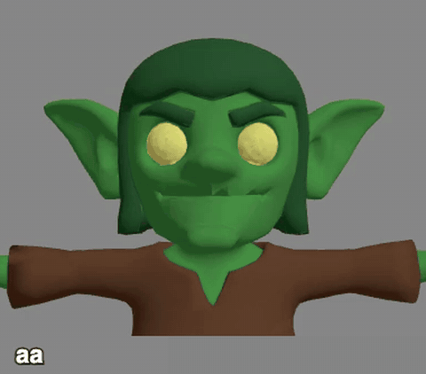

# glb-to-vrm (Node)

Convert a GLB (rigged or not), an existing VRM, or a single picture of a
character into a **VRM 1.0 avatar that talks, blinks and shows emotions**:
humanoid bones, five visemes (`aa ih ee oh ou`), `blink`, `blinkLeft`,
`blinkRight`, `happy`, `angry`, `surprised`, plus a preview video of every
expression. A client and CLI for the [Riggle API](https://riggle3d.com/en/guides/vrm-api/),
one file, zero dependencies, Node 18+.

<p align="center"></p>

```bash
npm install glb-to-vrm
export RIGGLE_API_KEY=rgl_...   # from https://app.riggle3d.com/developers/
```

## CLI

```bash
npx riggle convert model.glb -o model.vrm --preview preview.mp4
npx riggle convert --image hero.png -o hero.vrm
npx riggle convert --image sheet.png -o hero.vrm --fix   # or --force
npx riggle fix-picture sheet.png -o fixed.png
npx riggle balance
npx riggle list
```

## Library

```js
import { Riggle, ConversionFailed } from 'glb-to-vrm';

const client = new Riggle(); // reads RIGGLE_API_KEY, or pass the key in
try {
  const conversion = await client.convert('model.glb', 'model.vrm');
  for (const warning of conversion.warnings) console.log('check the preview:', warning);
} catch (error) {
  if (error instanceof ConversionFailed) console.log(error.message); // the tokens were returned
  else throw error;
}

await client.convert({ image: 'hero.png', output: 'hero.vrm', preview: 'hero.mp4' });
```

A model takes 1-3 minutes, a picture 3-6. The client uploads, polls, and
downloads the VRM; uploads carry an `Idempotency-Key`, so a retry never
starts and charges a second conversion.

## Pricing

Paid in API tokens, bought in packs on the
[developers page](https://app.riggle3d.com/developers/): 10 tokens for a
model, 25 for a picture. A conversion that fails returns its tokens.

## Links

- API reference: <https://riggle3d.com/en/guides/vrm-api/>
- OpenAPI spec: <https://riggle3d.com/openapi.json>
- Examples (curl, batch, three-vrm viewer, GitHub Action): <https://github.com/riggle3d/glb-to-vrm>
- Python client: `pip install glb-to-vrm`

MIT licensed.
