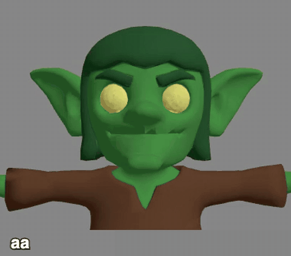

# glb-to-vrm (Python)

Convert a GLB (rigged or not), an existing VRM, or a single picture of a
character into a **VRM 1.0 avatar that talks, blinks and shows emotions**:
humanoid bones, five visemes (`aa ih ee oh ou`), `blink`, `blinkLeft`,
`blinkRight`, `happy`, `angry`, `surprised`, plus a preview video of every
expression. A client and CLI for the [Riggle API](https://riggle3d.com/en/guides/vrm-api/),
one file, standard library only, Python 3.9+.

<p align="center"></p>

```bash
pip install glb-to-vrm
export RIGGLE_API_KEY=rgl_...   # from https://app.riggle3d.com/developers/
```

## CLI

```bash
riggle convert model.glb -o model.vrm --preview preview.mp4
riggle convert --image hero.png -o hero.vrm
riggle convert --image sheet.png -o hero.vrm --fix   # or --force
riggle fix-picture sheet.png -o fixed.png
riggle balance
riggle list
```

## Library

```python
from riggle import Riggle, ConversionFailed

client = Riggle()  # reads RIGGLE_API_KEY, or pass the key in
try:
    conversion = client.convert("model.glb", "model.vrm", preview="preview.mp4")
    for warning in conversion["warnings"]:
        print("check the preview:", warning)
except ConversionFailed as failure:
    print(failure.message)  # the tokens were returned

client.convert(image="hero.png", output="hero.vrm")
```

The package installs the module `riggle` and the `riggle` command.

A model takes 1-3 minutes, a picture 3-6. The client uploads, polls, and
downloads the VRM; uploads carry an `Idempotency-Key`, so a retry never
starts and charges a second conversion.

## Pricing

Paid in API tokens, bought in packs on the
[developers page](https://app.riggle3d.com/developers/): 10 tokens for a
model, 25 for a picture. A conversion that fails returns its tokens.

## Links

- API reference: <https://riggle3d.com/en/guides/vrm-api/>
- OpenAPI spec: <https://riggle3d.com/openapi.json>
- Examples (curl, batch, three-vrm viewer, GitHub Action): <https://github.com/riggle3d/glb-to-vrm>
- Node client: `npm install glb-to-vrm`

MIT licensed.
